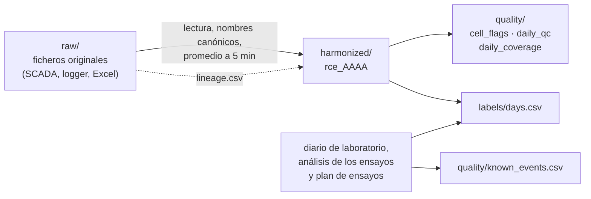

# Estructura de carpetas del dataset RCE

Guía para orientarse en el dataset: qué hay en cada carpeta, cómo se nombran los ficheros y las columnas, y cómo se
relacionan entre sí. Las definiciones de cada variable están en [`data_dictionary.csv`](data_dictionary.csv); los
términos técnicos, en [`glossary.md`](glossary.md).

## Vista general

```text
rce-dataset/
│
├── README.md                  Presentación, años cubiertos, inicio rápido y avisos de uso
├── CHANGELOG.md               Cambios de cada versión
├── CITATION.cff               Cómo citar el dataset (DOI de Zenodo)
├── LICENSE                    Licencia CC BY 4.0
├── datapackage.json           Descripción legible por máquina (Frictionless Data): ficheros, columnas y tipos
├── validation_report.md       Resultado de las comprobaciones automáticas del paquete
│
├── harmonized/                ◆ LOS DATOS — una tabla por año, rejilla de 5 minutos
│   ├── rce_2019.parquet         (cada año en dos formatos con el mismo contenido:
│   ├── rce_2019.csv              .parquet, compacto y tipado; .csv, legible con cualquier programa)
│   ├── rce_2022.parquet │ .csv
│   ├── rce_2023.parquet │ .csv
│   ├── rce_2024.parquet │ .csv
│   └── rce_2025.parquet │ .csv
│
├── labels/                    ◆ QUÉ PASÓ CADA DÍA
│   └── days.csv                 Una fila por día y unidad: si funcionó, cuándo circuló el agua, tipo de ensayo
│
├── quality/                   ◆ CUÁNTO FIARSE DE CADA VALOR
│   ├── cell_flags.parquet │ .csv  Celdas con valor que NO deben leerse como medida (una fila por celda)
│   ├── daily_coverage.csv       Porcentaje útil de cada grupo de sensores, por día
│   ├── daily_qc.csv             Resumen diario de calidad: huecos, marcas, valores fuera de rango
│   ├── known_events.csv         Incidencias del diario de laboratorio (averías, paradas, cambios)
│   ├── known_issues.md          Problemas conocidos explicados en texto (numerados, #1, #2…)
│   └── lineage.csv              Qué ficheros originales hay detrás de cada día
│
├── raw/                       ◆ DE DÓNDE SALE TODO (en GitHub solo los índices)
│   ├── index.csv                Catálogo de los 220 ficheros originales publicados
│   ├── excluded.csv             Ficheros originales que no se publican y por qué
│   └── checksums.sha256         Huella SHA-256 de cada fichero original publicado
│
└── docs/                      ◆ CÓMO ENTENDERLO
    ├── estructura_carpetas.md   Esta guía
    ├── glossary.md              Glosario para no especialistas
    ├── sensors_and_site.md      Sensores, instrumentos y emplazamiento
    ├── data_dictionary.csv      Diccionario: variable, unidad, descripción, sensor, años disponibles
    ├── variable_map.yaml        Correspondencia nombre original (SCADA/logger) → nombre armonizado
    ├── methodology.md           Cómo se construyó el dataset paso a paso
    └── experiment_types.md      Tipos de ensayo (1 a 4) y cómo se asignan
```

> **GitHub y Zenodo.** Este repositorio contiene el núcleo del dataset. Los 220 ficheros originales (unos 1,16 GB) se
> publican solo en Zenodo, en `rce-dataset-vX.Y.Z-raw.zip`; el núcleo está también en `rce-dataset-vX.Y.Z-core.zip`. Si
> se descomprimen los dos ZIP en la misma carpeta, todo queda reunido en `rce-dataset-vX.Y.Z/`, con los originales en
> `raw/` junto a sus índices. DOI de todas las versiones: [10.5281/zenodo.23386246](https://doi.org/10.5281/zenodo.23386246).

## El recorrido de los datos



Los valores originales no se modifican: lo que se corrige o se descarta se **marca** en `quality/`, nunca se borra ni se
interpola.

## Las carpetas, una a una

### `harmonized/`: los datos

Una tabla por año con **un valor cada 5 minutos**. Contiene 766 días: 37 de 2019, 94 de 2022, 258 de 2023, 181 de
2024 y 196 de 2025. 2021 no tiene datos; 2020 solo está en `raw/` (`quality/known_issues.md` #11). Las columnas son las mismas todos los años; si un sensor no
existía ese año, su columna aparece vacía.

| Bloque de columnas | Columnas | Qué indican |
|---|---|---|
| Tiempo y unidad | `date`, `ts_local`, `ts_utc`, `system` | Día, hora local de Lleida tal como se registró, hora UTC calculada y unidad medida |
| Recuento de muestras | `n_samples`, `n_tanks`, `n_circuit`, `n_surface`, `n_flow`, `n_pressure`, `n_ambient`, `n_solar`, `n_ir` | Cuántas lecturas originales hay detrás de cada intervalo, en total y por grupo de sensores; `n_samples = 0` significa intervalo sin datos |
| Depósitos | `t_hot_tank_c`, `t_cold_tank_c`, `t_cold_tank_l1_c` … `l3_c` | Temperatura del depósito caliente (150 L), del frío (50 L) y de las sondas por altura del depósito frío (2025) |
| Superficie del panel | `t_surface_1_c` … `t_surface_6_c` | Seis sondas sobre el panel |
| Circuito hidráulico | `t_circuit_1_c` … `t_circuit_11_c`, `t_aux_tank_22_c` … `24_c` | Temperaturas del circuito; `t_circuit_2_c` es la entrada al panel y `t_circuit_4_c` la salida |
| Caudal y presión | `flow_rce_l_min`, `flow_collector_l_min`, `p_circuit_1_bar`, `p_circuit_2_bar` | Caudal en litros por minuto y presión en bar |
| Meteorología | `t_ambient_c`, `rh_ambient_pct`, `wind_speed_m_s` | Temperatura exterior, humedad relativa y velocidad del viento |
| Radiación | `solar_global_w_m2`, `ir_net_w_m2`, `ir_down_w_m2`, `t_pyrgeometer_c`, `ir_raw_signal` | Radiación solar global horizontal; infrarroja neta del pirgeómetro (negativa = pérdida neta hacia el cielo); infrarroja atmosférica descendente y temperatura del cuerpo del pirgeómetro (2024–2025); señal infrarroja sin convertir |

**La columna `system`** dice qué equipo se midió:

| Valor | Periodo | Qué es |
|---|---|---|
| `RCE` | 2019–2024 | El prototipo único |
| `RCE-a` | 2025 | Unidad A: el prototipo original, automatizado en 2025 y gobernado por el controlador |
| `RCE-b` | 2025 | Unidad B: construida en 2025 a su lado como banco de ensayo manual |

Hay un solo pirgeómetro (sensor de infrarrojo), instalado en la unidad A. Su medida vale para las dos unidades.

### `labels/`: qué pasó cada día

`days.csv` tiene una fila por **día y unidad**, 945 en total.

| Columna | Significado |
|---|---|
| `date`, `system` | El día y la unidad |
| `operated` | `True` si el equipo funcionó, `False` si estuvo parado; vacío si los datos no permiten saberlo |
| `flow_period` | Cuándo circuló el agua: `day`, `night`, `day+night` o `none`. Dice que hubo circulación, **no** si el panel calentaba o enfriaba |
| `campaign_evidence` | Campaña experimental documentada a la que pertenece el día, por ejemplo `RC summer 2019` (enfriamiento radiativo, verano de 2019) |
| `exp_type`, `exp_confidence`, `exp_source` | Tipo de ensayo (1 a 4, o `unknown`), con qué seguridad se asigna (`high`, `medium`, `low`) y de dónde sale |
| `diary_flag` | `unreliable` si el laboratorio declaró el día poco fiable; `event` si anotó una incidencia |
| `notes` | Observaciones |

El tipo de ensayo solo se asigna cuando lo documenta el análisis del laboratorio de los ensayos nocturnos de 2023–2024
(`exp_source = lab_analysis`, que prevalece) o el diario de laboratorio (`exp_source = diary:<fecha>`). Las definiciones
están en [`experiment_types.md`](experiment_types.md).

### `quality/`: cuánto fiarse de cada valor

| Fichero | Una fila por | Para qué sirve |
|---|---|---|
| `cell_flags` | Celda marcada (`system`, `ts_local`, `variable`, `flag`) | **Quitar estas celdas antes de analizar.** Tienen valor, pero no es una medida válida |
| `daily_coverage.csv` | Día y unidad | Porcentaje del día con datos útiles en cada grupo: depósitos, circuito, superficie, caudal, presión, ambiente, solar e infrarrojo |
| `daily_qc.csv` | Día y unidad | Huecos (`max_gap_min`), valores fuera de rango, celdas marcadas por tipo y sensores sospechosos |
| `known_events.csv` | Incidencia | Inicio, fin, qué ocurrió, a qué afecta, gravedad y fuente |
| `known_issues.md` | Problema conocido | Explicación en texto. El README remite a él por número (#5, #11…) |
| `lineage.csv` | Día y fichero original | Qué fichero de `raw/` alimenta cada día |

Tipos de marca en `cell_flags`:

| `flag` | Qué significa |
|---|---|
| `zero` | Temperatura exactamente en 0,0 °C durante al menos 1 h (sonda no conectada), o solarímetro a 0 W/m² o menos todo el día |
| `scada_invalid` | El SCADA marcó la lectura como no válida, pero la hoja mensual procesada la copió igualmente |
| `stuck` | Sensor clavado: el mismo valor repetido durante al menos 12 h |
| `frozen` | Registro congelado: al menos el 80 % de las variables sin cambios durante 1 h o más |
| `definition_differs` | Periodo documentado en el que ese canal medía otra cosa (el valor se conserva; ver `docs/variable_map.yaml`) |

### `raw/`: de dónde sale todo

Ficheros originales tal como salieron del SCADA (WinCC), del registrador de 2019 y de las hojas mensuales procesadas.
Están **deduplicados por SHA-256**, de modo que cada contenido aparece una sola vez aunque estuviera copiado en varias
carpetas. Al descomprimir `raw.zip` de Zenodo se obtienen estas carpetas:

```text
raw/
├── 2019/        109 ficheros   (registrador 2019, incluidos 3 binarios .hdt)
├── 2020/          2 ficheros
├── 2022/          2 ficheros
├── 2023/         50 ficheros
├── 2024/         34 ficheros
├── 2025/         11 ficheros
└── live-2025/    12 ficheros   (exportaciones directas de WinCC de 2025: Lecturas, Pyrgeometer, Solarimeter…)
```

Cada fichero se llama `<8 primeros caracteres del SHA-256>_<nombre original>`, por ejemplo
`live-2025/7457d345_Lecturas0.csv`. El prefijo evita colisiones entre ficheros con el mismo nombre.

Columnas útiles de `index.csv`:

| Columna | Significado |
|---|---|
| `published_path` | Ruta dentro de `raw/` |
| `source_basenames` | Nombre o nombres originales del fichero |
| `kind` | `instrument_export` (exportación de un instrumento), `processed_workbook` (hoja mensual procesada), `spreadsheet_copy` (copia en Excel de una exportación), `hand_edited` (editado a mano) o `logger_binary` (binario del registrador) |
| `reader_hint` | Cómo leerlo: separador, codificación, separador decimal y columnas |
| `used_in_harmonized` | Si alimenta la capa armonizada |
| `sha256`, `sha256_published`, `sanitized` | Huella del original y de la copia publicada. En los Excel solo se han vaciado los metadatos personales; los valores de las celdas no se tocan |

## Cómo se nombran las columnas

Los nombres siguen el patrón **`magnitud_lugar_unidad`**, en inglés y en minúsculas:

```text
t_cold_tank_c        →  t (temperatura) · cold_tank (depósito frío) · c (°C)
flow_rce_l_min       →  flow (caudal) · rce (panel) · l_min (L/min)
solar_global_w_m2    →  solar (radiación solar) · global · w_m2 (W/m²)
n_tanks              →  n (número de lecturas) · tanks (grupo depósitos)
```

| Prefijo | Magnitud | Sufijo | Unidad |
|---|---|---|---|
| `t_` | Temperatura | `_c` | °C |
| `flow_` | Caudal | `_l_min` | L/min |
| `p_` | Presión | `_bar` | bar |
| `rh_` | Humedad relativa | `_pct` | % |
| `wind_speed_` | Velocidad del viento | `_m_s` | m/s |
| `solar_`, `ir_` | Radiación solar, infrarroja | `_w_m2` | W/m² |
| `n_` | Número de lecturas en el intervalo | — | recuento |

## Cómo se cruzan los ficheros

| Para saber… | Une | Por las columnas |
|---|---|---|
| Qué tipo de día era una medida | `harmonized/` con `labels/days.csv` | `date` + `system` |
| Qué valores descartar | `harmonized/` con `quality/cell_flags` | `system` + `ts_local` + nombre de la columna (`variable`) |
| Si un día es aprovechable | `labels/days.csv` con `quality/daily_qc.csv` y `daily_coverage.csv` | `date` + `system` |
| De qué fichero original sale un día | `quality/lineage.csv` con `raw/index.csv` | `raw_file` ↔ `published_path` |
| Qué significa una columna | Cualquier tabla con `docs/data_dictionary.csv` | nombre de la columna ↔ `variable` |

## Por dónde empezar

1. [`glossary.md`](glossary.md), si el equipo es nuevo para ti.
2. `labels/days.csv`, para elegir los días: `operated = True` y sin `diary_flag = unreliable`.
3. `harmonized/rce_AAAA.parquet` de ese año, filtrando por `date` y `system`.
4. Quitar las celdas de `quality/cell_flags` y comprobar la cobertura en `quality/daily_coverage.csv`.
5. Ante cualquier duda sobre una variable, consultar [`data_dictionary.csv`](data_dictionary.csv) y
   `quality/known_issues.md`.
