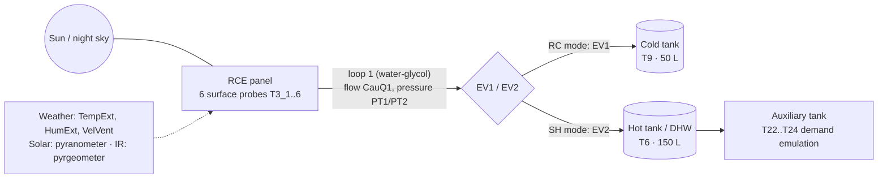

# Sensors, installation and site

## Site
- Location: Universitat de Lleida campus, Lleida (Spain). Approximate coordinates 41.62 N, 0.62 E (the values used by the
  project simulator); exact coordinates, panel orientation and tilt: **to be confirmed by the team**. [source: simulator/mockups]
- Climate: continental Mediterranean (hot dry summers, cold foggy winters).

## Device
| Item | Value | Source |
|---|---|---|
| Panel | BAXI SOL200 flat solar collector, 1.753 × 1.147 m, aluminium frame, modified cover | A1 Materials and Methods |
| Hot tank (DHW) | 150 L, GREENHEISS | docs/02_rce_context.md |
| Cold tank (CWT) | 50 L, GREENHEISS | docs/02_rce_context.md |
| HTF | water-glycol 30 % (loops 1/2); water (loop 3) | A1; DECISION_LOG D-011 |
| Units | one unit until 2024; two units A / B from 2025 (one automatic, one manual test bench; which is which: **to be confirmed by the team**) | meeting minutes 05/2026; docs/02_rce_context.md (pending) |

## Sensors
| Sensor | Model / type | Accuracy | Canonical variables | Years |
|---|---|---|---|---|
| Temperature probes | Pt-100 RTD | ±0.045 % | t_hot_tank_c, t_cold_tank_c, t_circuit_*, t_surface_*, t_cold_tank_l* | 2019–2025 |
| Flowmeter | Schmidt Mess SDNC 503 | ±4 % | flow_rce_l_min (flow_collector_l_min in 2019) | 2019–2025 |
| Pressure transmitters | PT1, PT2 | — | p_circuit_1_bar, p_circuit_2_bar | 2023–2025 |
| Pyranometer / solarimeter | (tag IO_SENSOR1_DATA); mounting plane to be confirmed | — | solar_global_w_m2 | 2019–2024 (down in 2025) |
| Pyrgeometer | LP PIRG 01 DeltaOhm | ±5 % | ir_net_w_m2 (2019, 2024–25), ir_raw_signal (2023–24) | 2019–2025 |
| Weather | outdoor station | — | t_ambient_c, rh_ambient_pct, wind_speed_m_s | 2019–2025 (wind from 2023) |

Accuracy values come from Table 2 of the energy paper draft (A1), as cited in `docs/02_rce_context.md`.

## Simplified diagram

[source: docs/02_rce_context.md installation diagram; drawings 22UDL03 / 25UDL01 are not included in this package]
