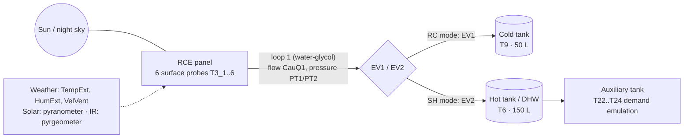

# Sensors, installation and site

## Site
- Location: roof of the CREA building of the Escola Politècnica Superior (EPS), Universitat de Lleida, Lleida (Spain).
  Approximate coordinates 41.62 N, 0.62 E.
- Climate: continental Mediterranean (hot dry summers, cold foggy winters).

## Device
| Item | Value |
|---|---|
| Panel | BAXI SOL200 flat solar collector, 1.753 × 1.147 m, aluminium frame, modified cover |
| Hot tank (DHW) | 150 L, GREENHEISS |
| Cold tank (CWT) | 50 L, GREENHEISS |
| HTF | water-glycol 30 % (loops 1/2); water (loop 3) |
| Units | one unit until 2024; from 2025, unit A (the original prototype, automated) and unit B (manual test bench), side by side |

## Sensors
| Sensor | Model / type | Accuracy | Canonical variables | Years |
|---|---|---|---|---|
| Temperature probes | Pt-100 RTD | ±0.045 °C | t_hot_tank_c, t_cold_tank_c, t_circuit_*, t_surface_*, t_cold_tank_l* | 2019–2025 |
| Flowmeter | Schmidt Mess SDNC 503 | ±4 % | flow_rce_l_min (flow_collector_l_min in 2019) | 2019–2025 |
| Pressure transmitters | PT1, PT2 | — | p_circuit_1_bar, p_circuit_2_bar | 2023–2025 |
| Pyranometer / solarimeter | (tag IO_SENSOR1_DATA); model and mounting plane not documented | — | solar_global_w_m2 | 2019–2025 (faults in 2025, see `quality/known_issues.md` #4) |
| Pyrgeometer | LP PIRG 01 DeltaOhm, one sensor on unit A (applies to both units) | ±5 % | ir_net_w_m2 (2019, 2024–25), ir_raw_signal (2022–24) | 2019–2025 |
| Weather | outdoor station | — | t_ambient_c, rh_ambient_pct, wind_speed_m_s | 2019–2025 (wind from 2023) |

The accuracies are those stated for the same Pt-100, SDNC 503 and LP PIRG 01 instrument types in the published proof
of concept of the device (S. Vall, M. Medrano, C. Solé, A. Castell, Energies 13 (2020) 893,
https://doi.org/10.3390/en13040893). No calibration records are available for 2022–2025.

## Simplified diagram

Simplified from the installation diagrams of the laboratory; the electrical drawings 22UDL03 / 25UDL01 are not
included in this package.
